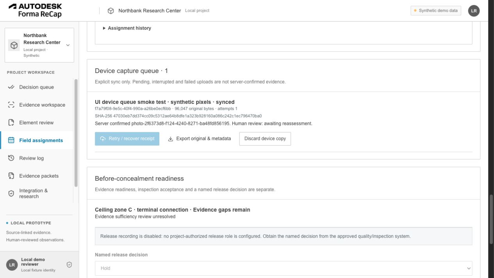
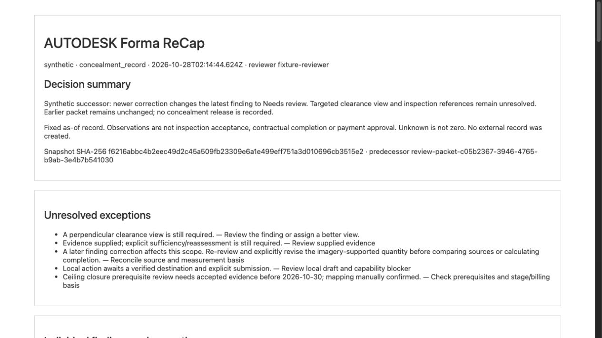
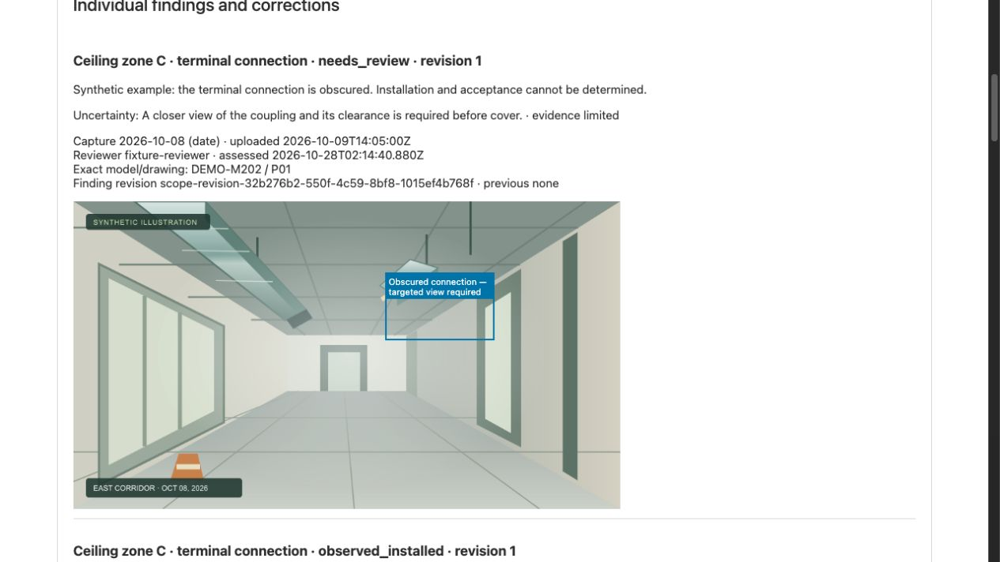

# Broader recommendation implementation — version 0.3

This delivery extends the existing React/Vite, native Node HTTP and SQLite application at `ce1a006`. It implements the local workflow portions of the broader recommendations. It does **not** declare all 23 roadmap tickets production-complete. The initial M1 changes remain intact. The original planning backlog and private supplied references remain unchanged outside this public source tree.

The new **Decision queue** is the initial screen. Existing Evidence workspace, Element review, Review log, old packet downloads, APS read-only connection and the supplied PNG logo remain available. The sidebar's prototype/reviewer block stays at the bottom; the expanded navigation scrolls independently. Field and research panels load separately. Credentials remain server-side; the public deployment still rejects all mutations and private workspaces.

## Delivered behavior and ticket boundaries

| Ticket / recommendation | Implemented | Remaining dependency or limitation |
| --- | --- | --- |
| FR-005 — stable BIM-optional scope | Drawing, takeoff, asset, custom and model-backed items; stable identity; duplicate import keys; optional versioned units/denominators and source mappings. A new local scope-only project imports and assesses photographs without a model ID. | Manual source references; no automatic geometric validation. Existing model findings are bridged as preserved records and assessed through the original element editor. |
| FR-006 — revision impact | Added/removed/replaced/renamed/split/merged mapping proposals, explicit confirmation/rejection, affected-record and denominator flags, immutable old references. | Changes are entered explicitly. Automated model/drawing/takeoff diff and proposed identity inference need accessible representative source versions and format validation. A confirmed mapping never transfers installed quantity automatically. |
| FR-007 — dossier | Item captures, independent finding revisions, separate annotation data, uncertainty, field tasks, quantities, drafts, packet references and explicit conflict/resolution history. Date-only and unknown capture dates retain their precision. | No automatic resolution of contradictory views, removal/rework or identity. Independent custom-scope drafts are keyed by exact item revision and capture. |
| FR-008 — weekly decision queue | Missing/stale/unknown-date evidence, unresolved/conflicting findings, overdue requests, supplied-but-unreviewed evidence, quantity differences/basis gaps, local follow-ups and lookahead prompts. Applied freshness/period, trade, location, owner and deadline filters; source links and supported next actions. | This is a local decision queue, not a schedule or payment decision engine. Deadline filtering excludes unknown deadlines explicitly. |
| FR-009/010 — planned field work | Versioned trade/stage criteria, planned assignments before a finding, required viewpoint and marked example image, owner/deadline/concealment, acknowledgment, inability/reassignment, manual sharing, evidence delivery and sufficient/still-insufficient review. Criteria can be selected as an exact version in a custom-scope finding. | No notification provider, authenticated field participants or delivery receipt is configured. Local actor identity is self-asserted. Individually confirmed findings are supported; batch AI review/automatic bulk assessment is not enabled. |
| FR-011 — offline capture | IndexedDB stores original Blob/hash, capture precision, task/scope revision and stable operation ID. Pending/syncing/failed/conflict/synced states, explicit retry, export/discard, quota errors, exact server receipts and interrupted-upload recovery. | Assignment view must already be loaded. No cached app shell for cold offline launch, native background upload or representative-device validation. Loopback server is unreachable from another phone; production mobile use needs shared HTTPS, authentication, retention policy and durable shared storage. |
| FR-012 — concealment readiness | Required evidence, sufficiency and inspection references remain separate; readiness/hold/release/exception records and correction-impact logic are implemented and tested. | Release writes are disabled by default. No project-approved release authority is configured; no actual quality release or inspection acceptance is claimed. |
| FR-013–015 — Autodesk follow-through | Current official documentation register; capability investigations that cannot forge verified access; local Issue/RFI destination previews and manual follow-up histories, ownership/deadlines/reported responses; evidence-backed asset identity/status proposals and correction flags. | No verified Issue/RFI/Asset write adapter, project permission, attachment receipt, supported transition or returned Autodesk record ID. Publication remains disabled. Manual external references are explicitly unverified. See [exact integration dependencies](INTEGRATION-RESEARCH.md). |
| FR-016 — comparison | Explicit temporal versus design questions, item-focused source selection, exact design-version reference, viewpoint/lighting/occlusion limitations and saved comparison notes. | Actual model viewing, matched-viewpoint registration and geometric overlays require a verified source/viewable/alignment process. Overlay and metric-deviation controls remain disabled. |
| FR-017 — quantity discipline | Reusable versioned scope/unit/stage/method/period-versus-cumulative templates; manual takeoff/SOV source mapping; explicit denominator; sourced unknown/known category records; comparable-only arithmetic; duplicate/overlap suppression. Later scope, baseline or finding corrections trigger re-review. | No automatic measurement, guessed unit conversion or free-text method equivalence. Named approval is a recorded claim, not verified contractual authority. Bulk source-file import and automated cost exchange remain separate work. |
| FR-018 — packets and correction impact | Four purpose presets, concise decisions/exceptions, exact record checkboxes, full selected histories, unchanged originals and separate annotations, version 0.3 manifest, predecessor/change lists, current correction notices and immutable HTML/JSON snapshots. Older 0.1/0.2 packets remain byte-identical. | A notice updates current metadata, never distributed files. No automatic retraction, certification or legal-integrity claim. |
| FR-019/020 — recognition experiment | Frozen duct/terminal protocol, permissions/ground-truth basis, training versus held-out splits, separate class/identity/visibility/stage/quantity labels, calibration gates, named manual/imported proposals, accept/edit/reject/abstain history and held-out evaluation. Decisions do not change findings or approved quantities. | **No detector, representative construction dataset or real recognition/measurement accuracy is available.** The saved example deliberately abstains and fails the minimum-data gate. It exercises evaluation bookkeeping, not an AI model. |
| FR-021 — lookahead/commercial review | Manual source/version/activity/billing-line mappings; delivered/installed/tested/accepted stages, dates, mapping rationale and billing exclusions; linked review prompts. | No connected schedule/cost service; no actual start/finish, earned value, delay or payable amount inferred. |
| FR-022 — owner handover | Confirmed local asset/location identity, before-cover/inspection/test/commissioning/warranty/O&M requirements, missing/reference-supplied/reviewed-local states, linked dossier and handover packet. | External reference access, owner acceptance and Tandem transfer are unverified. Supplied links alone do not complete readiness. |
| FR-023 — pilot visibility | Explicit start/pause/resume/complete/cancel events and active effort, incomplete/cancelled work, separate field delivery and review events, local continue/change/stop pilot records; absent human/AI/ROI metrics remain null. | No real pilot or independently measured benefit. Rollout decisions are local records; production feature rollout and authenticated participant telemetry require an agreed deployment/pilot policy. |

## Saved acceptance example

The example was generated in a new isolated directory using `npm run demo:broader`; normal working databases and the original seed were not modified. All media and authored quantities in this example are explicitly synthetic. The integrated no-model HTTP test additionally imports actual decoded PNG bytes into a temporary **local test workspace**; this validates the mechanism, not representative construction-photograph sufficiency.

1. A drawing item on **DEMO-M202 P01**, Level 02 East wing, Ductwork, retains its own identity with `model_ref:null`.
2. October 8 evidence receives Needs review and a separate rectangle identifying the obscured connection.
3. A before-cover requirement is assigned and acknowledged, with an owner, marked example, viewpoint, deadline and inspection reference.
4. The bundled synthetic PNG is received for October 26. Repeating the same client operation returns the same capture/receipt. Delivery does not create a finding or acceptance.
5. A separate October 26 finding records the visible coupling. Explicit evidence-sufficiency review remains independent of inspection acceptance and release.
6. A cumulative manual template records 12 m reported, 9 m imagery-supported, unknown unresolved/inspection values and a sourced 20 m denominator. Before the later correction, its explicitly bounded arithmetic is a 3 m source difference and 45% manual ratio — never an image-derived quantity or review-count percentage.
7. A local RFI retains the original gap and subsequent finding. Lookahead and owner-document gaps remain separate.
8. A weekly packet freezes that state. A later correction says the clearance is unsupported, preserving both earlier findings. Its related supported quantity now requires explicit re-review, so **current difference and completion are unknown**. A concealment successor retains the correction and predecessor; the earlier report remains unchanged.
9. A synthetic research case records an abstention because no detector is connected. Minimum held-out population is not met. No production accuracy or automatic quantity is claimed.

[Saved record IDs and checks](BROADER-VALIDATION.json) · [First weekly report](examples/weekly-review.html) · [Weekly manifest](examples/weekly-review.manifest.json) · [Corrected successor report](examples/concealment-successor.html) · [Successor manifest](examples/concealment-successor.manifest.json)

## Reproduce and inspect

```sh
npm ci
npm run build
npm test
npm run demo:broader -- --data-dir data/broader-demo
PORT=8083 npm run demo -- --data-dir data/broader-demo
```

Choose a new empty directory for setup. A populated directory is refused. Open `http://localhost:8083/`; the default Decision queue explains each exception. Open the Ceiling zone C dossier, Field assignments, Measurement basis, Follow-up drafts and Decision packets. The initial and successor records are saved, not generated by merely opening a tab. New IDs vary per setup and are written to the isolated directory's `broader-demo-records.json`.

For real authorized media use a separate Local photographs workspace. Configure a scope-only package from Decision queue, create an item, plan a field assignment and use Supply photograph. Choose unknown, date-only or offset-bearing capture precision explicitly. IndexedDB storage is local to the browser **origin/device**, separate from server persistence. Export unsent files before clearing browser storage; no silent deletion is performed.

Direct interface checks confirmed: saved annotation loading; item A draft → different item blank → item A exact draft restored; explicit discard; a new custom scope saved through the form; original PNG queued, retained across full reload, then synced only after an exact hash/assignment receipt; an unchanged original displayed with separate annotations; current correction notices; readable fixed successor report; and narrow-layout controls. Native phone behavior, cold offline launch and live project operations were not validated.

Direct assignment links open the saved assignment with planning forms collapsed. The new drawing/custom findings also appear in a separate Review log register. A deliberately unavailable field-view asset produced a recoverable workspace alert with the shell intact; restoring the asset and choosing Reload recovered the saved assignment. No user evidence or database file was modified by that failure check.

## Integrity, verification and operations

The new tables are additive and append-only; they do not rewrite the legacy finding, assessment, placement, source or packet tables. New HTTP operations share existing session, CSRF, origin and workspace guards. Public cloud writes are rejected before body processing. Unknown project/workspace/record references fail without a synthetic fallback. Module tests use temporary/in-memory data; browser writes used only isolated synthetic QA stores.

The full suite passed **152 tests**, with no failures or skips. It includes no-model end-to-end HTTP flow, field interruption/deduplication, immutable histories, exact source references, dates/unknowns, scoped exports, template revisions, period/cumulative separation, overlap suppression, later correction impact, bounded percentages, research split/calibration/abstention and external-write boundaries. Production build and diff checks pass; the pre-existing lucide-react directive warnings are nonblocking. The source/readable-report inspection also confirmed all four original packet downloads remain byte-identical and the new HTML's embedded manifest equals its downloaded JSON with a matching canonical snapshot hash.

Back up the full `data/` directory and browser-unsent originals before deployment. Reverting the 0.3 application can leave its additive tables intact; do not overwrite a newer database with an older backup. The original packet readers remain available. This delivery is a local source/review branch and a reproducible demo; GitHub/Vercel production rollout has not been performed.






