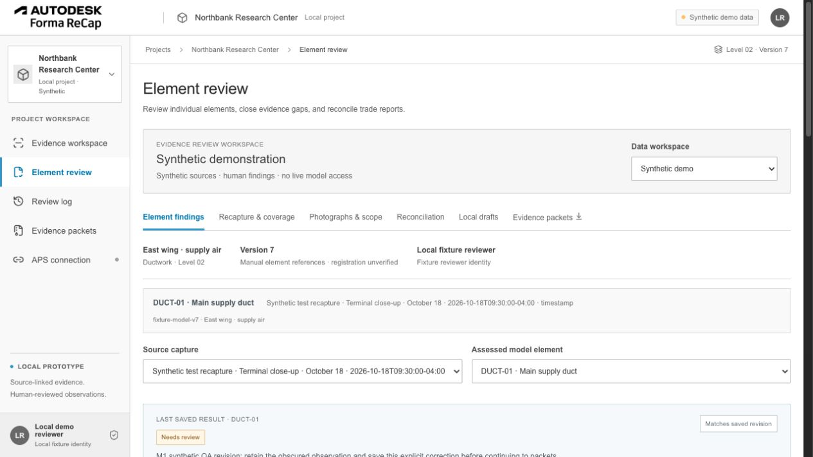
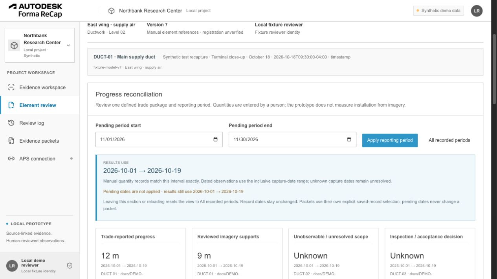

# M1 usability delivery — 2026-10-27

Selected scope: the user-invoked October 27 startup prompt, FR-001–FR-004 following the M0 audit, plus the bounded existing-data baseline from FR-023. The remaining 19 tickets are future work. The original handoff `BACKLOG.md` and `BACKLOG.json` remain unchanged in the local reference archive. Private meeting material, source references and credentials are not included in this delivery.

The existing React/Vite application, Node HTTP server, SQLite histories, evidence originals, brand image, calculation rules and export contracts are preserved. No database migration or new integration was introduced. This is a local, reviewable source delivery; production deployment is unchanged.

## Completed work

| Ticket | Result | Implementation / evidence |
| --- | --- | --- |
| FR-001 | Complete | [M0 audit](M1-AUDIT.md) classifies actual functionality, partial implementations and unverified integrations against source and tests. Starting checkout was clean at `ee463ce`. |
| FR-002 | Complete | A **Last saved result** panel displays the exact capture–element result or **Not assessed**, independently of editable draft values. Dirty indicators, four explicit navigation decisions, retained drafts, failed-save recovery and exact-response identity checks prevent pending edits from appearing saved. [Draft state](../../src/findingDraft.ts), [editor hook](../../src/useFindingDraft.ts), [workbench](../../src/ReviewWorkbench.tsx). |
| FR-003 | Complete | Pending date inputs differ from **Results use**. Apply validates the interval and uses the returned period; invalid or failed requests retain earlier results. Refreshes use the applied period, never the pending fields. Reset and no-match states keep unknown quantities unknown. [Period state](../../src/reportingPeriod.ts), [workbench](../../src/ReviewWorkbench.tsx). |
| FR-004 | Complete | One primary sidebar, genuine element-workflow tabs and a direct packet destination. Hash links preserve workspace, project, exact scope/model version, capture, element and related record. Back/Forward and guarded navigation retain context; unavailable references show an explicit error. Review-log actions open the originating finding, task and local draft. [Routes](../../src/reviewNavigation.ts), [navigation hook](../../src/useReviewNavigation.ts), [shell](../../src/App.tsx), [register](../../src/ReviewRegister.tsx). |
| FR-023 | Baseline only | [Versioned baseline](M1-BASELINE.json) records saved synthetic counts and packet/media digests. [Audit definitions](M1-AUDIT.md#fr-023-baseline-available-without-new-telemetry) identify measurement populations, exclusions and missing events. No human pilot, AI performance or time-saving result is inferred. |

## Validation evidence

Tests run against temporary stores; direct interface writes used a separate seed restored into `work/m1-qa-data`, served on loopback port 8081. The normal working databases, original seed and existing packet artifacts were not edited. Every QA capture and authored row was synthetic. A temporary test server deliberately rejected the first finding save with HTTP 503; that injection is not part of application source or the deliverable demo.

| Scenario | Observed result |
| --- | --- |
| AC-01 saved versus pending findings | An unassessed DUCT-01 on the October 18 imported synthetic capture stayed **Not assessed** while its Needs review draft was edited. DUCT-02 stayed explicitly unassessed. Save failure retained rationale and uncertainty and created no finding/revision; retry saved only the exact pair. Unchanged save was disabled. |
| Draft decisions | **Stay** kept the current editor; **Keep draft & continue** restored the exact draft when returning; **Discard & continue** removed only pending edits; **Save & continue** saved revision 2 before opening packets directly, with a single dialog. |
| AC-02 persistence and independence | Reload restored QA finding `finding-8ec4f013-0bcc-4ad2-8920-dfedde9c9a72`, revision 2, its predecessor, exact original capture/model references and rationale. The original DUCT-03 findings/annotations, recapture events and local RFI revision remained intact. DUCT-02 had no finding. |
| AC-04 pending versus applied dates | Applied October 1–19, edited November dates without Apply and confirmed that October results remained active. A reversed interval showed an error without replacing results. Applying November showed no matching records and unknown quantities. **All recorded periods** restored the full set. |
| Filter refresh regression | While October was applied and November pending, saving a null-quantity manual QA record refreshed against October. The pending November fields remained unapplied; 12 m reported, 9 m supported and the explicitly comparable 3 m difference remained separate from unresolved/inspection/approval unknowns. |
| Related records and stale links | Review log → original DUCT-03 gap → related recapture → originating finding retained the exact references and annotation. Related local draft opened saved RFI revision 2 with its two selected findings. A missing capture link showed an unavailable-context explanation without selecting a replacement. |
| History, keyboard and narrow layout | Single and repeated Back/Forward while a finding was dirty were checked with Stay/continue decisions. At 390 px, the sidebar toggle and Enter navigation opened packets, closed the drawer and retained context. Document width did not exceed the viewport. The temporary viewport override was reset. This is responsive desktop-browser QA, not a mobile/offline support claim. |
| Snapshot and source preservation | After QA corrections, HTTP reads matched all four earlier reports byte-for-byte and all four manifests structurally to their original files. The checked-in manifest bytes, seed digest and four original media hashes also matched the M0 baseline. [Machine-readable verification](M1-VALIDATION.json). |

Focused automated tests cover retained/discarded drafts, exact save identities, failed-save state, pending/applied period transitions, valid/invalid/legacy routes and foreign references. The full repository suite also covers revisions, date precision, quantity comparability and nulls, duplicate suppression, packet immutability, CSRF, APS mocks and the read-only Vercel boundary. **Final `npm test`: 101 passed, 0 failed, 0 skipped** (87 existing plus 14 new state/navigation checks). **`npm run build` and `git diff --check` passed.** The build emits the existing nonblocking lucide-react `use client` directive warnings. Repeated-Back cancellation/continuation and Back during a pending primary-navigation dialog were additionally verified in the running browser after the final navigation fix.

[Failed-save draft view](images/M1-failed-save.jpg) · [Narrow packet view](images/M1-mobile-packets.jpg)

## Reproduce the usability checks

1. Build the project and restore the saved synthetic seed into a **new, empty directory** using `npm run demo:setup -- --data-dir /absolute/path/to/new-demo`. Run `PORT=8081 npm run demo -- --data-dir /absolute/path/to/new-demo`. The setup refuses an existing nonempty directory. Use the normal port if available.
2. Open Element review → Synthetic demo → October 18 imported test capture → DUCT-01. Its seeded state is Not assessed. Edit a finding and navigate to another element or Review log to try the four draft decisions. Saving creates an independent synthetic finding; DUCT-02 remains unassessed. Reload to inspect its persisted revision. The deliberate 503 scenario requires a test fault or an unavailable server; the shipping demo has no injected failure.
3. Open Reconciliation. Apply October 1–19, then edit November dates. Read **Results use**, the pending indicator and the observation-period label. Apply an invalid interval, then a valid empty interval; reset with All recorded periods. Record values and capture dates are unchanged by filtering.
4. Open Review log and use DUCT-03's related task/draft actions. Use Back/Forward. From the workbench, open Evidence packets directly and inspect the retained context. Existing packet downloads remain the original fixed snapshots.

The pre-seeded public demo remains read-only. Run the local demo for writes and save-failure/draft interactions. The isolated browser-QA database is local verification material, not a replacement for the checked-in seed.

## Boundaries and next work

Draft retention is in memory for this browser session. It does not provide crash recovery, offline storage or cross-device synchronization. A full reload warns while a finding draft is dirty; saved records survive reload. Other workflow forms retain their existing behavior. Reconciliation deliberately starts at all periods on section entry/reload, with that reset stated in the UI; pending date inputs are never a claim about active results.

The legacy Evidence workspace supports its two original synthetic captures. An imported/local capture cannot be rendered there as if it were one of those captures; unavailable context is explained with an explicit return action. Current model links are manual, unverified associations. APS model viewing, representative construction photographs, external submissions, AI, automatic measurement and field/offline operation were not validated or added.

Dependency-ready candidates are **FR-005** (BIM-optional stable scope, after FR-001) and **FR-013** (integration feasibility, after FR-001, requiring authorized project/format/permission evidence). **FR-007** follows FR-002 and FR-005. FR-023's real pilot collection remains dependent on an agreed population and event capture. Select the next increment separately; this delivery does not implement the entire 23-ticket roadmap.
