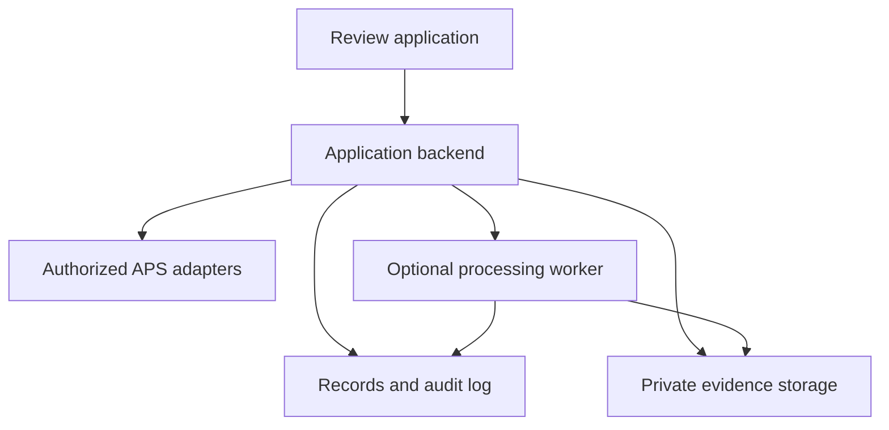

# Architecture and data model

This is a proposed implementation design. Choose actual framework, database, storage, SDK, and hosting versions during repository inspection. It is not a deployed architecture.

## System boundaries

The browser displays captures, plans, model context, assessments, and write previews. The backend enforces authorization, validates domain state, controls evidence access, and performs APS calls. The database tracks records and immutable revisions. Private storage holds original media and derived evidence. A worker is added when reconstruction, media conversion, or later AI analysis needs asynchronous processing.

Codex is the implementation assistant. It need not be embedded in the running product. A future vision service is an optional backend dependency with its own credentials, usage costs, model/version records, and evaluation. APS supplies documented services; it does not supply the complete domain logic.

## Adapters and modes

Keep interfaces for `ProjectCatalog`, `ModelContext`, `CaptureStore`, `IssuePublisher`, and optional `VisionAnalyzer`. Implement domain logic independently of APS response shapes. Persist normalized source references and the raw response version needed for debugging, excluding secrets and signed URLs.

- `fixture`: synthetic records and private local demo files; no live APS or external vision writes. UI and exports show "Synthetic demo data". A simulated publication is labeled simulated and cannot produce a live-success state.
- `live`: actual authorized records. Missing configuration, authentication failure, or network failure is an error. No silent fixture fallback.

Reject unknown modes. Do not permit fixture project IDs or evidence to cross into live write operations. Use separate databases/buckets/namespaces or enforce equivalent isolation. A fixture preview is not a live approval.

## Proposed records

| Record | Minimum fields and purpose |
|---|---|
| Project binding | Internal ID, data mode, tenant, hub/project source IDs, region, adapter version, access-check result. No stored plaintext credentials. |
| Model reference | Source project, item/model ID, exact version ID, derivative/viewable reference if available, units/offset metadata, translation state, retrieval time. |
| Element reference | Model version plus source external element ID. Viewer-local IDs may be cached only with the matching derivative/version. |
| Scope revision | Project, model version, floor/zone, trade label, explicitly included elements or location-defined scope, author, revision, mapping rationale. Overlap is allowed only when explicit and never double-counted silently. |
| Capture | Project, original media ID, private storage reference, content hash, media type, upload time, capture date/time and precision, date source, original timezone if known, uploader, source/license context. |
| Derivative | Original capture ID/hash, derivative hash, transformation/crop information, generated time, tool/version. Preserve a route back to the original evidence. |
| Capture placement | Method, plan/model reference and version, coordinate-space definition, normalized plan pin and/or explicit 3D transform, units, author, time, review state. A 2D pin is not a camera pose. |
| Assessment revision | Project/scope/model/capture references, state, human reviewer identity, reviewed time, evidence, uncertainty reason, rationale, predecessor revision. See the proposed JSON contract. |
| AI suggestion, optional | Provider/model/version, input evidence and crop references, prompt/pipeline version, suggested state, uncertainty, run time, immutable raw result, subsequent human decision. Separate from the authoritative assessment. |
| Evidence packet | Immutable snapshot ID, source hashes, capture date provenance, model/scope versions, selected assessment revisions, generation time, artifact hash, access-controlled references. |
| Write operation | Project, exact approved payload hash and packet revision, approver/time, local operation key, status, attempts, remote Issue ID, per-attachment outcomes, reconciliation result. |
| Audit event | Actor, project, action, affected record/revision, timestamp, correlation ID, reason. No access tokens or signed source URLs. |

## State conventions

An assessment describes a particular scope at a particular capture date. Allowed values:

- `observed_installed`: a reviewer considers the visible evidence sufficient to support the stated installation observation.
- `not_observed`: the selected evidence does not show the scope. Absence, occlusion, inadequate capture, and incompatible views remain distinguishable in the rationale.
- `needs_review`: the evidence or interpretation does not support a useful conclusion yet.

For the initial contract, `not_observed` and `needs_review` require an uncertainty reason. An `observed_installed` assessment still requires source evidence and a bounded rationale; it cannot certify inspection, testing, quantity, or payment.

MVP observations are human-authored/reviewed. If later AI suggestions are added, accepting them creates a human assessment revision referencing the suggestion. Rejecting/correcting them does not delete the original output. A model's numerical confidence is not automatically a calibrated accuracy measure.

## Time and identity

Store recorded events with timezone-aware timestamps. Preserve capture precision: exact timestamp, date-only, or unknown. Never convert an upload time into a claimed capture time. Display date-only evidence without a fabricated time of day. Preserve the original timezone/date source where available.

Assessment identity is not just an element ID. It includes the project, scope revision, model version, capture reference, assessment revision, and reviewer. A new model version does not mutate old findings. Flag affected assessments as using an earlier design reference; require a new review when remapping them.

For the MVP, every authoritative visual evidence entry in an assessment must reference its selected capture. Compare dates through separate assessments. Cross-date imagery may be displayed as contextual comparison but cannot be inserted as authoritative evidence for a different capture date. Enforce this application-level invariant on writes and exports.

## Media and spatial rules

Keep original imagery immutable. Validate uploads, size/format limits, filenames, storage ownership, and malware controls appropriate to deployment. Use short-lived access where required. Do not place access credentials or signed URLs in permanent exports.

Manual plan placement may use normalized x/y in [0,1], anchored to a specific plan version and documented origin. A later 3D registration must record coordinate system, units, transform, source method, and review state. Only claim measured alignment error when actually computed against an independent reference.

An exported packet preserves the chosen evidence snapshot. Reviewer-facing exports should be human readable; include a machine-readable manifest for reproduction. An offline export includes the permitted media it needs or states explicitly that a reference requires authenticated access. Do not silently produce broken temporary links.

## Approved Issue workflow

```mermaid
stateDiagram-v2
    [*] --> Draft
    Draft --> Approved: Exact payload approved
    Approved --> Sending: Recheck access and sources
    Approved --> Draft: Payload or evidence changed
    Sending --> Complete: Issue and evidence confirmed
    Sending --> Partial: Issue exists; evidence incomplete
    Sending --> Uncertain: Create outcome unknown
    Partial --> Complete: Retry missing evidence only
    Uncertain --> Complete: Issue and evidence confirmed
    Uncertain --> Partial: Existing Issue; evidence incomplete
    Uncertain --> Approved: Confirmed no create occurred
```

The diagram omits rejected authorization/configuration errors for clarity; implement explicit failure states and useful recovery messages. A network timeout is not proof that create failed. Store a local operation key and reconcile using supported identifiers/readback. APS idempotency headers or custom correlation fields must be verified rather than assumed.

Approval covers project, title, subtype/status, location text/references, evidence packet revision, and selected attachments. Relevant changes invalidate approval. Recheck project authorization immediately before publishing. Log the remote ID as soon as known and track upload/attachment steps independently. Never create a second Issue merely because attaching evidence failed.

Native Photos-gallery upload, native Issue pushpins, and arbitrary relationship writes are separate capabilities. The initial application uses its own plan pins and supported file/attachment or secured-link workflows.

## Progress reporting

Default reports show source-linked observations and review coverage. If counts are shown, label their basis and distinguish scoped expected items, reviewed items, observed items, and unresolved items. Do not call the ratio of visible elements a contractual percent complete or earned value. Quantity/unit/weighting decisions belong to a separately validated extension.
